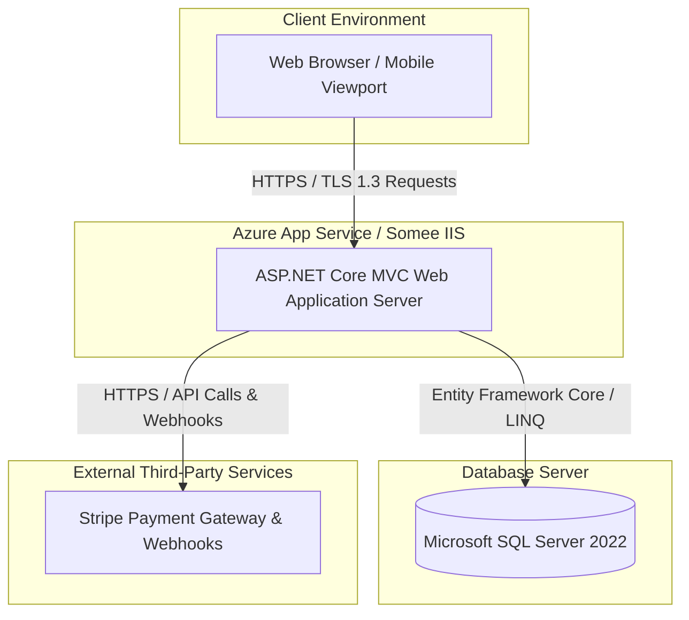
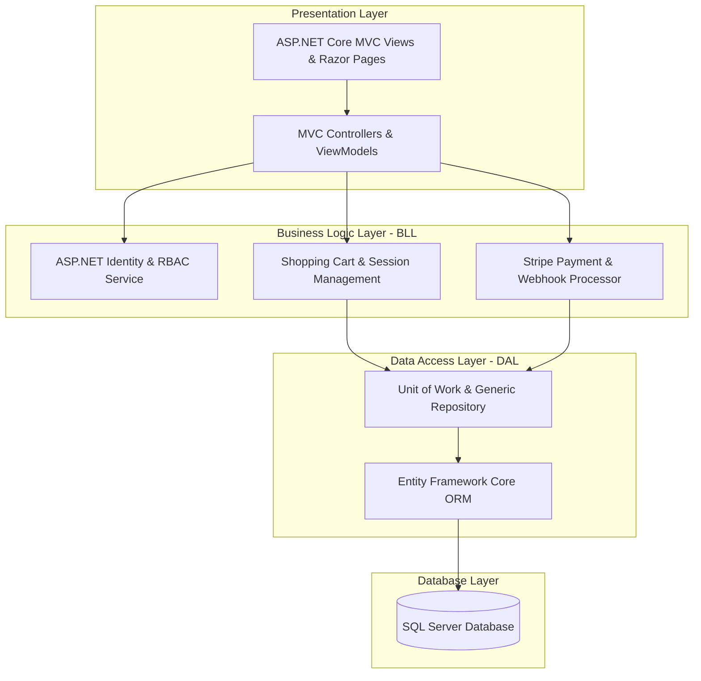

مخطط النشر (Deployment Diagram)

مخطط المكونات (Component Diagram)

4. التقنيات النهائية المستخدمة (Tech Stack)
5. 
5. توثيق المسارات البرمجية وواجهات التحكم (Controller Endpoints)
6.

6. خطة الاختبار (Testing Plan)
لضمان جودة النظام وخلوه من الأخطاء قبل التسليم النهائي، تم وضع خطة اختبار شاملة تتضمن:

Unit Testing (الاختبارات الوحدة):

اختبار دوال الحسابات الرياضية في سلة التسوق (إجماليات الأسعار، الضرائب، وخصومات الكمية).

التحقق من سلامة عمل الـ Repositories واستعلامات الـ LINQ.

Integration Testing (اختبار التكامل):

اختبار ربط الـ Entity Framework بقاعدة بيانات SQL Server والتأكد من نجاح الـ Migrations واستقرار العلاقات بين الجداول.

اختبار الربط الآمن مع Stripe Test API والتأكد من تطابق الـ Webhooks.

Payment & Webhook Simulation:

محاكاة عمليات الدفع الناجحة والفاشلة باستخدام بطاقات اختبار Stripe، والتحقق من التحديث الفوري لحالة الطلب في قاعدة البيانات.

User Acceptance Testing (UAT):

اختبار صلاحيات الوصول المختلفة (RBAC) والتأكد من أن العميل، الأدمن، وعامل التوصيل يمتلكون الصلاحيات المخصصة لهم فقط دون تداخل.

7. استراتيجية النشر (Deployment Strategy)
إعدادات بيئة العمل (Environment Variables):

تخزين بيانات الاتصال الحساسة بقاعدة البيانات (ConnectionStrings) ومفاتيح السر الخاصة ببوابة الدفع (StripeSettings:SecretKey) بشكل آمن داخل ملفات الإعدادات السحابية (appsettings.json أو لوحة تحكم سحابة Azure).

ترحيل قاعدة البيانات (Database Migration Strategy):

تشغيل أوامر النشر المحدثة لتطبيق الجداول على سيرفر الإنتاج:

dotnet ef database update --configuration Release
إدارة النشر السحابي (Cloud Hosting):

نشر التطبيق على بيئة Azure App Service أو خادم Somee IIS، مع تفعيل شهادات الحماية HTTPS / TLS 1.3 لتأمين بيانات العملاء والبطاقات الائتمانية أثناء الدفع.

